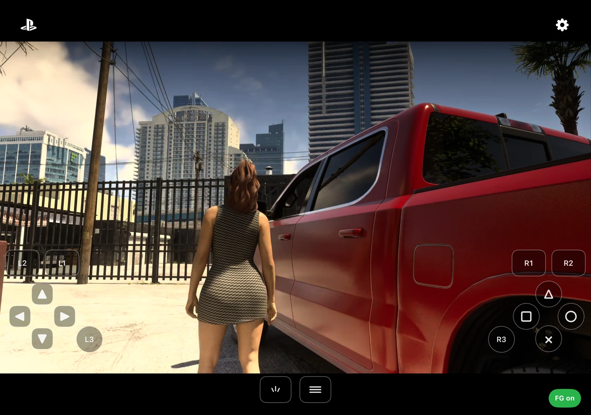
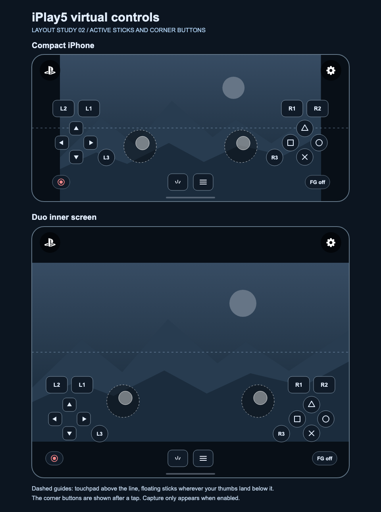

<p align="center"></p>

# iPlay5: PS5 Remote Play for iPhone and iPad

iPlay5 is a free, open-source PS5 Remote Play app for iPhone and iPad. Stream your PlayStation 5 over your local network (or from away with port forwarding) with DualSense haptics and adaptive triggers, gyro aiming, HDR and up to 1080p60. It's built on [chiaki-ng](https://github.com/streetpea/chiaki-ng)'s core, tuned for the iPhone Duo's near-square inner screen, and works on any iPhone or iPad running iOS 17 or later. Install it by sideloading with AltStore, SideStore or Sideloadly.

<p align="center"></p>

> [!IMPORTANT]
> **Play with a physical controller or virtual controls.** Auto keeps the virtual controls out of the way when you have a supported controller connected, such as a DualSense, Xbox controller, or Backbone. Change this in Settings › Virtual controls.
>
> **iPhone Duo recommendation:** the [GameSir G8+](https://gamesir.com/products/g8plus-bluetooth-mobile-controller) **Bluetooth** version works well clipped onto the Duo. Avoid the Apple-specific (USB-C) G8 version, because it doesn't work with the Duo. Pair the G8+ in its iOS mode (blue Home light), where it shows up as "DUOLSHOK 4 Wireless Controller", and iPlay5 uses its built-in gyro for motion controls and gyro aiming.
>
> **3D-printable shim:** the G8+'s grip can press the Duo's side button and trigger Siri mid-game. I made a free [iPhone Duo shim for the GameSir G8+](https://makerworld.com/en/models/3648382-iphone-duo-shim-for-gamesir-g8-no-siri-presses) on MakerWorld that stops it.

Not affiliated with or endorsed by Sony Interactive Entertainment. "PlayStation" and "PS5" are trademarks of Sony Interactive Entertainment Inc.

## Features

The highlights are below. The [feature guides](docs/README.md) cover everything in detail, and the [changelog](CHANGELOG.md) lists what changed in each release.

- **Sharp, low-latency picture:** hardware H.265/H.264 decoding drawn with Metal at the screen's native resolution, up to 1080p60 (the PS5's Remote Play limit) and up to 200 Mbps. HDR10, Fit or Zoom to fill, Sharp or MetalFX upscaling, and a 120 Hz screen on ProMotion iPhones. [Picture](docs/picture.md)
- **Frame generation:** an in-between frame for each pair the PS5 sends, so 30 fps looks like 60 and 60 like 120, for half a frame of extra delay. [Picture](docs/picture.md#frame-generation)
- **Full DualSense support:** touchpad, motion, haptics with the game's texture, adaptive triggers and the lightbar all follow the game. Xbox trigger motors play trigger effects, and controllers without motors get haptics on the phone instead. [Controllers](docs/controllers.md)
- **Gyro aiming:** turn the controller (or the phone) to aim with the right stick, even in games without gyro support, always or only while holding L2 or R1. [Controllers](docs/controllers.md#gyro-aiming)
- **Controller Test:** a 3D DualSense that mirrors your controller live, with buttons to try rumble, haptics, trigger effects and lights. [Controllers](docs/controllers.md#controller-test)
- **Virtual controls:** floating or fixed sticks, three sizes and adjustable opacity, shown only when you don't have a controller. The touchscreen works as the DualSense touchpad. [Touch and virtual controls](docs/touch-and-virtual-controls.md)
- **A connection that looks after itself:** Auto bitrate learns what works for each console on each network, Optimise connection suggests settings in one tap, optional network smoothing rides out Wi-Fi stutter, and the stream reconnects after drops and quick app switches. [Connection](docs/connection.md)
- **Microphone:** game and party chat through the phone's mic, with a mute button on the stream. [Audio](docs/audio.md)
- **Easy setup:** finds your PS5 automatically, links with PSN sign-in, wakes it from rest mode, and lets each console have its own settings. [Consoles and setup](docs/consoles-and-setup.md)
- **Play away from home:** give a console a remote address and iPlay5 uses it when the console isn't on your local network. No PSN internet play needed, but your router has to forward the Remote Play ports. [Consoles and setup](docs/consoles-and-setup.md#playing-away-from-home)
- **Made for the iPhone Duo:** streams on the inner screen, set up on the outer one, and folding pauses the stream. [iPhone Duo](docs/iphone-duo.md)
- **Handy extras:** type into PS5 text boxes with the iPhone keyboard, battery and temperature in the stream menu, and screenshots saved to Files. [The stream screen](docs/stream-screen.md)

## Install

iPlay5 isn't on the App Store. You install the `.ipa` from [Releases](https://github.com/reefbarman/iPlay5/releases) yourself with a sideloading tool, signed with your own Apple ID. A free Apple ID is enough because the app needs no special permissions. Free-account apps expire after 7 days unless they're refreshed, which SideStore and AltStore do in the background.

**SideStore or AltStore (recommended, gets updates):** add this source, then install iPlay5 from it:

```
https://raw.githubusercontent.com/reefbarman/iPlay5/main/altstore-source.json
```

**Sideloadly or another signer:** download `iPlay5.ipa` from the latest release and install it as you would any other IPA.

**Developer account:** if you have a paid Apple Developer account, you can build from source (below) and the app lasts a year.

## First run

1. Put the PS5 and phone on the same network. On the PS5, enable **Settings › System › Remote Play › Enable Remote Play**. To wake it from rest mode, also turn on **Settings › System › Power Saving › Features Available in Rest Mode › Stay Connected to the Internet** and **Enable Turning On PS5 from Network**.
2. Open iPlay5 and allow **Local Network** access when asked. Tap **+**.
3. Your PS5 should appear under Console. If it doesn't, use **Enter IP address manually**.
4. Tap **Sign in to PSN** to fill in your account ID. If your passkey or password manager doesn't work in the sign-in window, use the **Safari** option and paste the URL you end up on.
5. On the PS5, open **Settings › System › Remote Play › Link Device**, enter the PIN in the app and tap **Link**.
6. Tap **Play**. If you don't have a controller connected, choose **Use virtual controls**, **Connect without controls**, or **Cancel**. Tap the picture to click the PS5 touchpad, or slide your finger to swipe. With virtual controls showing, the touchpad is the upper half, and you start a stick in the open space on either side of the lower half.

While streaming: tap the top-right corner, then the gear, to open settings. Or hold **Select + Start** for a second. Tap the top-left corner, then the PlayStation logo, to press the PS button.

Start at 1080p60 with H.265. HDR needs H.265 and HDR enabled on the PS5. For the most reliable stream, use 5 GHz Wi-Fi with the PS5 wired to the router. Bitrates above 100 Mbps need a strong connection (ideally the PS5 on Ethernet and 5 GHz or 6 GHz Wi-Fi) or you may see stutter.

## Controls guide

Open **Controls Guide** from Settings › Controller or the in-stream menu. The dashed line in the diagram marks the upper-screen touchpad; the dashed circles show example stick positions, not fixed touch targets. The PS and Settings buttons are shown after a corner tap. Capture only appears if enabled. See [The stream screen](docs/stream-screen.md) for every shortcut and menu option.

<p align="center"></p>

## Reporting a problem

Right after the problem happens (without closing the app), open **Settings › Share diagnostics** and attach the file to a [GitHub issue](https://github.com/reefbarman/iPlay5/issues/new). It has your phone model, screen details, settings and the app's logs since it was opened. IP addresses, keys, account IDs and console names are removed. It's plain text, so you can check it before sending. [Help and troubleshooting](docs/troubleshooting.md) has more tips, including the Controller Test and known limitations.

## Build from source

Needs a Mac with Xcode 16 or later and Homebrew.

```sh
brew install cmake ninja xcodegen
git clone --recursive https://github.com/reefbarman/iPlay5.git
cd iPlay5
scripts/build-chiaki.sh                                 # -> Frameworks/ChiakiKit.xcframework
cp Config/Local.xcconfig.example Config/Local.xcconfig  # set your team ID and a bundle ID
xcodegen generate                                       # -> iPlay5.xcodeproj
open iPlay5.xcodeproj                                   # run on your phone
```

To build the same unsigned IPA the releases use, run `scripts/package-ipa.sh`, which writes `build/iPlay5.ipa`. To publish a release, push a `v*` tag. The release workflow builds the IPA, attaches it to a GitHub release and adds it to `altstore-source.json`.

### Layout

| Path             | What                                                                                                                |
| ---------------- | ------------------------------------------------------------------------------------------------------------------- |
| `ChiakiKit/`     | iOS CMake build of chiaki-ng's lib (mbedTLS, Opus, no PSN internet play), plus `ck_bridge`, a small C API for Swift |
| `App/Chiaki/`    | Console discovery (unicast subnet sweep, so no multicast entitlement), wake, registration and PSN sign-in           |
| `App/Streaming/` | Session, VideoToolbox decoder, Metal renderer and shaders, audio, controller and touch input                        |
| `App/Views/`     | SwiftUI screens                                                                                                     |
| `Config/`        | Signing settings. Your team and bundle ID go in the git-ignored `Local.xcconfig`                                    |

`ChiakiKit/generated/takion.pb.*` are pre-generated from chiaki-ng's `lib/protobuf/takion.proto` with nanopb. Regenerate them after bumping chiaki-ng if the proto has changed.

`ChiakiKit/patches/*.patch` are applied to a copy of chiaki-ng's `lib` in the build directory, so the submodule stays untouched. If a chiaki-ng bump makes a patch fail, the CMake configure step stops with the rejected hunks.

## Credits and license

- [chiaki-ng](https://github.com/streetpea/chiaki-ng) and the original [Chiaki](https://git.sr.ht/~thestr4ng3r/chiaki) did the hard work of the Remote Play protocol. PSN sign-in follows chiaki-ng's flow.
- The Takion v20 support is ported from [P5M](https://github.com/beecrepaldi-afk/P5M-mac) (AGPL-3.0), the first open-source client to work out the v20 changes.
- Also bundled: [Mbed TLS](https://github.com/Mbed-TLS/mbedtls) (Apache-2.0), [Opus](https://opus-codec.org) (BSD), and nanopb and jerasure through chiaki-ng.

iPlay5 is licensed under the [GNU Affero General Public License v3.0](LICENSE) (AGPL-3.0-only), the same as chiaki-ng. If you distribute a modified build, you must make its source available under the same license. The app lists every bundled component and its licence under **Settings › About › Licences**, and [Licences and source code](docs/licensing.md) explains how to get the source for any version.

iPlay5 collects no data. It has no accounts, analytics or ads, and only talks to your PS5 and Sony's sign-in page. See the [privacy policy](docs/privacy.md).

`App/Resources/Licenses` holds the licence texts the app shows. They're copied from the submodules by `scripts/update-licenses.sh`, so run it after bumping a submodule and commit any changes.
