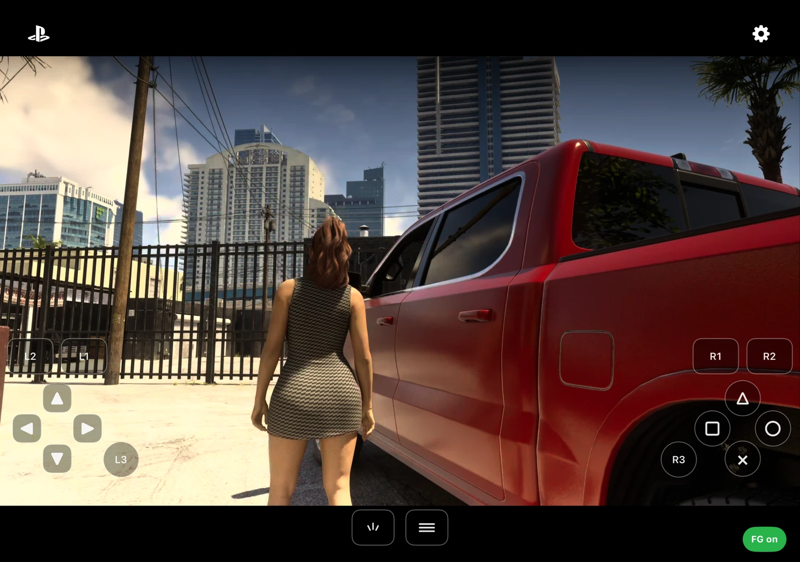

<p align="center"></p>

# iPlay5: PS5 Remote Play for iPhone and iPad

iPlay5 is a free, open-source PS5 Remote Play app for iPhone and iPad. Stream your PlayStation 5 over your local network (or from away with port forwarding) with DualSense haptics and adaptive triggers, gyro aiming, HDR and up to 1080p60. It's built on [chiaki-ng](https://github.com/streetpea/chiaki-ng)'s core, tuned for the iPhone Duo's near-square inner screen, and works on any iPhone or iPad running iOS 17 or later.

<p align="center"></p>

## Install

iPlay5 isn't on the App Store. You sideload it with your own Apple ID, and a free Apple ID is enough.

**SideStore or AltStore (recommended, gets updates):** add this source, then install iPlay5 from it:

```
https://raw.githubusercontent.com/reefbarman/iPlay5/main/altstore-source.json
```

**Sideloadly or another signer:** download `iPlay5.ipa` from the [latest release](https://github.com/reefbarman/iPlay5/releases/latest) and install it as you would any other IPA.

Then follow [Consoles and setup](consoles-and-setup.md) to link your PS5.

## Features

- **Sharp, low-latency picture:** hardware H.265/H.264 decoding at the screen's native resolution, up to 1080p60 and 200 Mbps, with HDR10, MetalFX upscaling and 120 Hz on ProMotion iPhones. [Picture](picture.md)
- **Full DualSense support:** touchpad, motion, haptics, adaptive triggers and the lightbar all follow the game. Xbox controllers and Backbone work too. [Controllers](controllers.md)
- **Gyro aiming:** turn the controller or the phone to aim, even in games without gyro support. [Controllers](controllers.md#gyro-aiming)
- **Virtual controls:** on-screen sticks and buttons when you don't have a controller, and the touchscreen works as the touchpad. [Touch and virtual controls](touch-and-virtual-controls.md)
- **A connection that looks after itself:** Auto bitrate, one-tap Optimise connection, network smoothing and automatic reconnecting. [Connection](connection.md)
- **Microphone:** game and party chat through the phone's mic. [Audio](audio.md)
- **Play away from home:** connect over the internet with a remote address and port forwarding. [Consoles and setup](consoles-and-setup.md#playing-away-from-home)
- **Made for the iPhone Duo:** streams on the inner screen, and folding pauses the stream. [iPhone Duo](iphone-duo.md)

## Guides

- [Consoles and setup](consoles-and-setup.md): finding and linking a PS5, PSN sign-in, waking, playing away from home
- [Picture](picture.md): resolution, bitrate, codecs, HDR, upscaling, 120 Hz, frame generation
- [Controllers](controllers.md): supported controllers, DualSense feedback, motion, gyro aiming, Controller Test
- [Touch and virtual controls](touch-and-virtual-controls.md): the touchscreen as a touchpad and on-screen controls
- [Connection](connection.md): Auto bitrate, Optimise connection, network smoothing, reconnecting
- [Audio](audio.md): game audio, AirPods, microphone and party chat
- [The stream screen](stream-screen.md): shortcuts, the stream menu, battery and heat, typing, screenshots
- [iPhone Duo](iphone-duo.md): inner and outer screens, folding, controller and shim recommendations
- [Help and troubleshooting](troubleshooting.md): sharing diagnostics and known limitations

Found a bug? [Open an issue](https://github.com/reefbarman/iPlay5/issues/new) with the file from **Settings › Share diagnostics**. The [changelog](https://github.com/reefbarman/iPlay5/blob/main/CHANGELOG.md) lists what changed in each release, and the [source is on GitHub](https://github.com/reefbarman/iPlay5) under AGPL-3.0.

Not affiliated with or endorsed by Sony Interactive Entertainment. "PlayStation" and "PS5" are trademarks of Sony Interactive Entertainment Inc.
