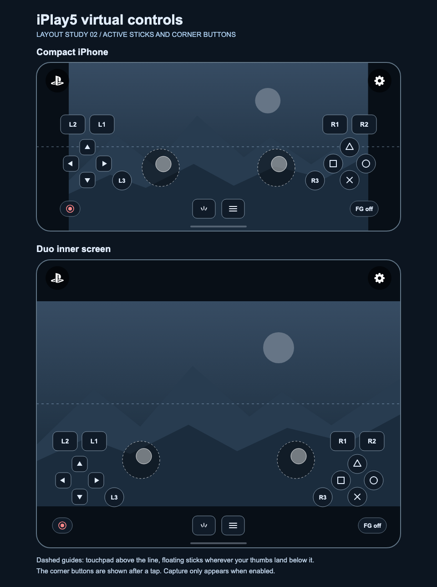

# Touch and virtual controls

## The touchscreen as the DualSense touchpad

- **Playing with a controller:** the whole picture is the touchpad. Touches in the black bars land on its nearest edge.
- **With virtual controls showing:** the upper half is the touchpad, and the lower half is for the sticks.
- Drag to move a finger (up to two at once). A quick tap clicks the touchpad.
- **Select button is touchpad click** (Settings › Controller) gives you a touchpad click on the controller too.

## Virtual controls

Play without a controller. Sticks float: touch open space on either side of the lower half and a stick starts under your thumb. The D-pad, face buttons, shoulders and triggers sit at the sides, with L3 and R3 diagonally inward from the D-pad and face buttons. Create and Options sit in the black bar below the picture if there's room, otherwise at the bottom centre.

Settings › Virtual controls:

| Setting      | Options                                                                              | Default |
| ------------ | ------------------------------------------------------------------------------------ | ------- |
| Show         | **Auto** (only when no supported controller is connected), Always show, Never show   | Auto    |
| Size         | Small, Medium, Large                                                                 | Medium  |
| Opacity      | 20% to 100%                                                                          | 100%    |
| Fixed sticks | Each stick stays in one spot on its side, and a touch near it moves it straight away | Off     |

- Starting a stream with no controller asks whether to **Use virtual controls**, **Connect without controls** or **Cancel**. That choice only lasts for the session. The stream menu shows it and offers **Use saved virtual controls setting**.
- With virtual controls, rumble and haptics play on the phone. See [Controllers › Vibration](controllers.md#vibration-and-feedback).
- **Phone gyro for motion controls** gives games motion from the phone.

## Controls Guide

Settings › Controller › Controls Guide, also in the stream menu. A diagram of the layout on a compact iPhone and on the iPhone Duo's inner screen, and a summary of the [stream shortcuts](stream-screen.md#corner-shortcuts). The dashed line marks the upper-screen touchpad, and dashed circles show example stick positions, not fixed touch targets.

